# 🚀 Awesome-LLM-Frameworks

  

   

## 🧭 The Complete List of LLM Frameworks, AI Agent Frameworks & LLM Orchestration Tools (2026)

### 🤖 Top LLM Frameworks Ecosystem

**Curated List of SaaS Products & Open-Source GitHub Projects**  

*Focused on Composable Orchestration, Agent Development & Production LLM Applications*  

**📅 Last updated: March 2026**

Looking for the **best LLM frameworks** in 2026? This **awesome list of LLM frameworks** curates the top **SaaS platforms** and **open-source LLM frameworks** for building **AI agents**, **RAG (retrieval-augmented generation) pipelines**, and **LLM orchestration** workflows — from **LangChain alternatives** such as LlamaIndex, Haystack, Dify and LangGraph to enterprise **AI agent builders** like Microsoft Copilot Studio, Cognigy and Kore.ai. Every entry links to the official project, and the comparison tables below cover **pricing**, **free tier limits**, and **vendor size** so you can pick the right **LLM framework** fast.

This repository tracks notable **SaaS platforms** and **open-source projects** for **LLM Frameworks**. These tools provide abstractions for prompts, chains, agents, tools, memory, and retrieval — enabling developers to build everything from simple RAG pipelines to complex multi-agent systems with composable building blocks.

**🏆 Examples** include Voiceflow, Botpress, Microsoft Copilot Studio, LangChain, Flowise, Retool, Stack AI, Dialogflow, Cognigy, and Kore.ai (the category leaders).

**🔓 Open-source emphasis**: This section is heavily expanded with every major active project for self-hosting, custom agent development, and transparent orchestration — ideal for AI engineers, product builders, and teams building vendor-neutral LLM applications.

💡 Contributions welcome! Open a PR to add/update entries. Keep descriptions factual and link to official sites.

## 📑 Table of Contents

- [📈 Sector Overview & Market Dynamics](#sector-overview--market-dynamics)

- [🏢 SaaS/Hosted Platforms](#saas-hosted-platforms)

- [🌐 Open-Source GitHub Projects](#open-source-github-projects)

- [❓ FAQ: LLM Frameworks & AI Agent Builders](#faq-llm-frameworks--ai-agent-builders)

- [🤝 How to Contribute](#how-to-contribute)

- [⚠️ Disclaimer](#disclaimer)

## 🏢 SaaS/Hosted Platforms

### 📊 Sector Overview & Market Dynamics

**💰 Market size**: The conversational-AI sector that these agent-building platforms compete in is estimated at **~$14.3B in 2025**, forecast to reach **~$78.9B by 2033** (Grand View Research), with the adjacent enterprise agentic-AI market alone projected to grow from $2.6B (2024) to $24.5B by 2030.

**🧩 Market structure**: The sector is **moderately fragmented** — not winner-take-all. Hyperscalers (Microsoft, Google) exert outsized influence, but specialized vendors (Cognigy, Kore.ai, Retool, Voiceflow, Botpress, Stack AI) and open-source alternatives keep winning enterprise share, and consolidation is accelerating (e.g., NiCE's ~$955M acquisition of Cognigy; Asana's acquisition of Stack AI).

All prices in USD, verified October 2026 (annual billing noted where it applies).

Sorted by company size (revenue / valuation) — largest first.

| 🏢 Platform | 📝 Description | 💲 Starting Price | 🎁 Free Tier / Trial | 📈 Company Size (Revenue / Valuation) |
|---|---|---|---|---|
| **[Dialogflow (Google)](https://cloud.google.com/dialogflow)** 💬 | Google's conversational AI platform for building chatbots and voice assistants with visual intent/entity editor; strong for Google Cloud deployments. | **CX: $0.007/text request** ($0.06/minute audio); **ES Essentials: $0.002/text request** | **ES Trial Edition**: free text requests capped at **180 requests/minute** (audio 1,000/day, 15,000/month); **CX: $600 trial credit valid 12 months** | Backed by **Alphabet (Google)**: >$350B annual revenue, ~$2T+ market cap |
| **[Microsoft Copilot Studio](https://www.microsoft.com/en-us/microsoft-copilot/microsoft-copilot-studio)** 🪟 | Low-code platform for building custom copilots integrated with Power Platform and Microsoft 365; strong enterprise adoption (55% user adoption per G2). | **Pay-as-you-go: $0.01 per Copilot Credit**; prepaid capacity pack **$200/month for 25,000 credits** | **30-day free trial environment**: create agents and test in the chat panel, publishing not included (extendable once by 30 days) | Backed by **Microsoft**: ~$281B FY2025 revenue, ~$3T+ market cap |
| **[Retool](https://retool.com/)** 🛠️ | Low-code platform for building internal tools and workflows with AI capabilities; Windmill serves as the leading open-source alternative. | **Team: $10/builder/month** + **$5/internal user/month** (billed annually) | **Free plan**: up to **5 users**, 250 pooled AI credits/month, 500 workflow runs/month, ~20 agent-hours/month, 5 GB stored data | **$3.2B valuation** (Series C2, 2022) |
| **[Cognigy](https://www.cognigy.com/)** 🤝 | Enterprise conversational AI platform (now part of NiCE) with visual flow editor for voice and chat automation; used by large contact centers. | **Per-conversation billing**: AWS Marketplace bundle **$43,080/year per 60,000 conversations** (~$0.72/conversation; one conversation = 50 user inputs within 24 h) | **30-day free trial** at trial.cognigy.ai (full flow editor and NLP in a sandbox environment) | **~$955M acquisition** by NiCE (2025) |
| **[Kore.ai](https://kore.ai/)** 🤖 | Enterprise virtual assistant platform with Bot Builder for NLP-enabled bots; 43% user adoption and 7-month payback period per G2. | **AWS Marketplace "AI for Service": $80,000/year platform fee + $0.20 per session** | **Free trial with $500 starting credit** (20 requests/minute; includes Conversation Designer, Dialog Builder, Knowledge Graph, Multi-Engine NLP) | **$150M strategic growth investment** (2024) |
| **[Botpress](https://botpress.com/)** 🤖 | Conversational AI platform with visual flow builder, built-in NLU, knowledge bases, and multi-channel deployment; open-source core with hosted cloud option. | **Plus: $150/month** (billed annually; 250 conversations included, extra packs $65 per 100 conversations) | **Free plan**: **100 conversations/month**, 3 seats, 3 agents, 1,000 table rows, 100 MB vector + 100 MB file storage | **$120M post-money valuation** (Series B, 2025) |
| **[Voiceflow](https://www.voiceflow.com/)** 🎙️ | Collaborative conversational AI design platform with visual flow builder for voice and chat agents; popular for prototyping and team-based agent design. | **Pro: $60/month** for the first editor (includes 10,000 credits/month) | **Free Sandbox**: 1 editor, 2 agents, **100 one-time credits** (credits do not renew monthly) | **$105M valuation** (2023 funding round) |
| **[Stack AI](https://www.stack-ai.com/)** 📚 | No-code platform for building AI workflows and applications with visual drag-and-drop interface for RAG pipelines, chatbots, and document processing. | **AWS Marketplace "StackAI Hosted": $120,000/year** (12-month contract, up to 5,000 runs/month); Enterprise otherwise custom-quoted | **Free plan**: **500 runs/month**, 2 projects, 1 seat (community support on Discord) | **$16M Series A** (2025); acquired by Asana (2026, terms undisclosed) |
| **[Flowise](https://flowiseai.com/)** 🔀 | Open-source drag-and-drop UI for building LLM flows and AI agents built on LangChain components; self-hostable with cloud offering. | **Cloud Starter: $35/month** | **Free cloud tier**: **2 flows, 2 assistants, 100 predictions/month, 5 MB storage** | Bootstrapped open-source-led company; funding/revenue not disclosed |

## 🌐 Open-Source GitHub Projects

🌟 All Stars_Badges are live counts from the shields.io API, sorted by stars (descending). Click a badge to open the repo's stargazers page.

-  **[AutoGPT](https://github.com/Significant-Gravitas/AutoGPT)** 🤖 — Autonomous agent platform descended from the viral GPT-4 experiment; build, host and run long-running AI agents with planning, memory and tool use.

-  **[Dify](https://github.com/langgenius/dify)** 🧩 — Most-starred open-source LLM platform combining orchestration, prompt management, evaluation, RAG pipelines, and deployment.

-  **[Langflow](https://github.com/langflow-ai/langflow)** 🌊 — Low-code visual builder for multi-agent and RAG applications; every flow is exposed as an API, with a managed cloud option.

-  **[LangChain](https://github.com/langchain-ai/langchain)** 🔗 — **The most popular general-purpose LLM framework** — provides abstractions for prompts, chains, agents, tools, memory, and 700+ integrations. Best for rapid prototyping and teams new to LLM development. Note: abstraction overhead and historical breaking changes are common challenges .

-  **[AutoGen (AG2)](https://github.com/microsoft/autogen)** 🦾 — Microsoft's multi-agent conversation framework; forked to AG2 after Microsoft Agent Framework merger .

-  **[CrewAI](https://github.com/joaomdmoura/crewAI)** 👥 — Multi-agent framework with crew-based orchestration and role-based agents.

-  **[Flowise](https://github.com/FlowiseAI/Flowise)** 🔀 — Visual drag-and-drop LLM workflow builder built on LangChain — connect LLMs, prompts, tools, memory, and vector stores into working applications without code. Self-hostable and popular for teams wanting LangChain power with a visual interface .

-  **[LlamaIndex](https://github.com/run-llama/llama_index)** 📚 — **Data-centric framework focused on RAG** — excels at document ingestion, indexing, and retrieval. Shines when the primary use case is connecting LLMs to data with complex document processing. Often used alongside LangChain for agent orchestration .

-  **[LangGraph](https://github.com/langchain-ai/langgraph)** 🕸️ — Graph-based agent orchestration from LangChain — requires explicit edge definition but provides powerful state management and checkpointing for complex multi-agent workflows. The recommended choice when agent state persistence matters .

-  **[Agno](https://github.com/agno-agi/agno)** ⚡ — Lightweight multimodal agent framework with built-in memory, knowledge and tool use; optimized for low latency and high throughput at scale.

-  **[LightRAG](https://github.com/HKUDS/LightRAG)** 💡 — Simple and fast retrieval-augmented generation with knowledge graph integration .

-  **[DSPy](https://github.com/stanfordnlp/dspy)** 🎯 — Stanford's framework for *programming* rather than prompting LLMs — composes pipelines as typed modules and compiles them into optimized prompts automatically.

-  **[OpenAI Agents SDK](https://github.com/openai/openai-agents-python)** 🧠 — Official SDK for building agentic applications with handoffs and guardrails.

-  **[smolagents](https://github.com/huggingface/smolagents)** 🤗 — Hugging Face's minimal agent library: code-writing agents that plan and act by emitting and executing Python snippets.

-  **[Semantic Kernel](https://github.com/microsoft/semantic-kernel)** 🪟 — **Microsoft's enterprise AI orchestration SDK** — native C#, Python, and Java support with Azure integration, planners for automatic function orchestration, and semantic memory. Ideal for .NET enterprise environments and making existing code AI-callable. Smaller community than LangChain but stronger typing and IDE support .

-  **[Vercel AI SDK](https://github.com/vercel/ai)** 🖥️ — TypeScript toolkit for building AI-powered streaming applications; different idioms from Python frameworks .

-  **[Haystack](https://github.com/deepset-ai/haystack)** 🌾 — **Production-ready orchestration framework** from deepset — modular pipelines and agent workflows with explicit control over retrieval, routing, memory, and generation. Built for scalable agents, RAG, multimodal applications, and semantic search .

-  **[Letta](https://github.com/letta-ai/letta)** 💾 — Stateful LLM agents with persistent, managed memory (formerly MemGPT); ideal for long-running agents that must recall context across sessions.

-  **[Windmill](https://github.com/windmill-labs/windmill)** 🌬️ — **Open-source Retool and Temporal alternative** — turns Python, TypeScript, Go, Bash, and SQL scripts into webhooks, workflows, and UIs with auto-generated forms. Rust backend is 13x faster than Airflow .

-  **[LangChain4j](https://github.com/langchain4j/langchain4j)** ☕ — Java port of the LangChain ecosystem for JVM enterprise stacks; brings LLM chat, RAG and agents to Spring-style Java services.

-  **[Rivet](https://github.com/ironclad/rivet)** 🔧 — Open-source visual AI programming environment for building AI agent chains with graph-based editor and code generation; production-ready platform .

-  **[PipesHub](https://github.com/pipeshub-ai/pipeshub-ai)** 🔌 — Open-source context layer for AI agents connecting Slack, Drive, Jira, GitHub, and Microsoft 365 .

-  **[Tiledesk](https://github.com/Tiledesk/tiledesk)** 💬 — **Open-source alternative to Voiceflow and Botpress** — full-stack live chat with built-in chatbots, visual no-code flow designer, and LLM/GPT AI integration with graph-based conversation design .

-  **[Sovrium](https://socket.dev/npm/package/sovrium)** 🗃️ — Configuration-driven web application platform — open-source alternative to Airtable, Retool, and Notion. Self-hosted with tables, automatic API, authentication, and pages defined in a config file. BSL-1.1 license .

**🛠️ Frameworks for building custom systems**: Combine **LangChain** or **Haystack** for orchestration, **LlamaIndex** for data ingestion and RAG, **LangGraph** for complex agent state management, and **Flowise** or **Rivet** for visual prototyping. For enterprise .NET environments, **Semantic Kernel** provides the strongest Azure integration and type safety . For customer-facing conversational agents, **Tiledesk** delivers a fully open-source Voiceflow alternative .

**💡 Key architectural insight**: Framework-specific patterns (orchestration topology, state management, planning strategies) vary significantly and should not be depended upon for portability. Universal patterns — tool registration via JSON Schema, MCP as interop protocol, conversation history as base memory, and structured output support — are safe to rely on across frameworks .

## ❓ FAQ: LLM Frameworks & AI Agent Builders

### What is an LLM framework?

An **LLM framework** is a library or platform that abstracts the raw LLM API into reusable components — prompts, chains, agents, tools, memory and retrieval — so you can build LLM applications such as **RAG pipelines** and **multi-agent systems** without wiring every API call yourself. Popular general-purpose LLM frameworks include LangChain, LlamaIndex and Haystack.

### Which is the best open-source LLM framework?

There is no single winner: **LangChain** is the most-starred general-purpose option, **Dify** and **Langflow** lead for visual no-code builders, **LlamaIndex** dominates document RAG, and **LangGraph** is the pick when agent state persistence matters. See the [star-sorted open-source table](#open-source-github-projects) for the full ranking by GitHub_Stars.

### What is the best no-code / visual AI agent builder?

For visual, low-code agent building, the main choices are **Flowise** and **Langflow** (open source) and **Voiceflow**, **Botpress**, **Microsoft Copilot Studio** and **Cognigy** (SaaS). The [SaaS comparison table](#saas-hosted-platforms) lists exact starting prices and free-tier limits for each.

### Are LLM frameworks free?

Yes — the open-source frameworks in this list (LangChain, LlamaIndex, Dify, CrewAI, DSPy, smolagents and many more) are free to self-host; you only pay your LLM provider (OpenAI, Anthropic, etc.). Hosted SaaS builders charge per editor, conversation, session or run, and most include a free tier or free trial — exact limits are in the [pricing table](#saas-hosted-platforms).

### SaaS vs open-source LLM platforms — which should I choose?

Choose **SaaS** (Copilot Studio, Cognigy, Kore.ai, Retool) when you need enterprise SLAs, compliance and support with no ops burden. Choose **open source** (Dify, Flowise, LangGraph, Haystack) when you want full data control, custom licensing, or deep customization of orchestration logic. Many teams prototype in SaaS and migrate hot paths to self-hosted frameworks in production.

### How big is the LLM framework market?

The conversational-AI market these platforms compete in is estimated at **~$14.3B (2025)**, growing to ~$78.9B by 2033, and is **moderately fragmented** — see [Sector Overview & Market Dynamics](#sector-overview--market-dynamics) for details and sources.

## 🤝 How to Contribute

1. 🍴 Fork the repo.

2. ✏️ Add/edit entries in `README.md` (follow existing format).

3. 📌 Include: name, link, 1–2 sentence description, and whether it's SaaS or open-source.

4. 🚀 Submit PR with a short explanation.

⭐ Star the repo if you find it useful!

## ⚠️ Disclaimer

- This is a **community-curated** list — not exhaustive and not an endorsement.

- LLM frameworks manage API keys and sensitive data; ensure proper secret management and access controls when self-hosting.

- 🔑 **License awareness**: Some frameworks use BSL or other non-standard licenses (e.g., Sovrium BSL-1.1) — verify commercial use terms before production deployment.

- Framework churn is high: Microsoft merged AutoGen and Semantic Kernel into Microsoft Agent Framework (October 2025), AutoGen forked to AG2, and CrewAI rebuilt without LangChain dependency. Evaluate long-term maintenance before committing .

## 📈 Star History

## 🙏 Support

**Thank you** for visiting this list — I hope it saves you hours of research on LLM frameworks, AI agent builders and LLM orchestration tooling. 🙌

If you find it useful, please consider:

- ⭐ **Starring** the repository — it takes a second and helps others discover it.
- 🍴 **Forking** it to add or improve entries.
- 📣 **Sharing** it with your team, community or on social media.

And if it has saved you real time, you can **[Buy me a coffee ☕](https://github.com/sponsors/ishandutta2007)** via the GitHub Sponsor Dashboard — thank you for your support!

---

**🎯 Made for AI engineers, application developers, platform teams, and open-source enthusiasts.**  
Let's make LLM application development more open, composable, and vendor-neutral. 🌍
